# RobotCart: SLICE Cart Lighting

Arduino sketch that runs the lights on the SLICE (team 8738) robot cart:

- **Side letters**: a 300-LED WS2812 strip that lights up the letters **S-L-I-C-E** on both sides of the cart, plus an internal white illuminator.
- **Matrix display**: a 64 x 16 NeoPixel matrix (four 32 x 8 panels) that shows text like `SLICE`, `8738` and `SLICE! SLICE! SQUEEZE!!`.

Two buttons step through the light programs. A microphone and two potentiometers drive a sound-reactive mode.

## Hardware / wiring

| What | Pin | Notes |
|---|---|---|
| Side LED strip data | `D4` | 300 x WS2812 (GRB, 800 KHz) |
| Matrix display data | `D7` | 2 x 2 tiles of 32 x 8 panels = 64 x 16 |
| "Next" button | `D9` | Active HIGH, needs a pull-down resistor |
| "Previous" button | `D8` | Active HIGH, needs a pull-down resistor |
| Microphone | `A0` | Analog level |
| Noise-floor pot (min) | `A1` | Used by the sound-reactive program |
| Sensitivity pot (max) | `A2` | Used by the sound-reactive program |

Power the LEDs from a proper 5 V supply rather than from the Arduino.

### Side strip layout

The strip snakes up and down the letters in six columns, three per side. ([LED map spreadsheet](https://docs.google.com/spreadsheets/d/1uPBvxobsNldO1_tUTYW7d_6D1sfJVXOsJzB6nNNpvE0/edit?usp=sharing))

| LEDs | Section |
|---|---|
| 0 – 41 | Right column 1 |
| 84 – 42 | Right column 2 (reversed) |
| 85 – 127 | Right column 3 |
| 128 – 170 | Internal illuminator (always white) |
| 171 – 213 | Left column 1 |
| 256 – 214 | Left column 2 (reversed) |
| 257 – 298 | Left column 3 |

A **row** (0–42) is one horizontal slice across all six columns, counted from the bottom of the E (0) to the top of the S (42). The letters map to rows as follows:

| Letter | Rows |
|---|---|
| S | 34 – 42 |
| L | 26 – 33 |
| I | 17 – 25 |
| C | 8 – 16 |
| E | 0 – 7 |

### Matrix display

The display is 64 px wide and 16 px tall. Text is drawn at size 2 (12 x 16 px per character), so about **5 characters** fit on screen at once. Longer phrases scroll.

## Programs

The cart powers up in program 0 (off). Use the top button for the next program and the bottom button for the previous one. Both wrap around.

Programs 1–6 are built around the team logo, 7–11 are rainbow themes, and 12–19 are the original programs.

| # | Side letters | Matrix |
|---|---|---|
| 0 | Off | Off |
| 1 | Turn cyan one letter at a time, S → E | Team logo, lighting each slice segment + digit of 8738 in turn |
| 2 | Fade in, turn cyan with the segments | **Zoom:** slice pops up, fills in, slides into place as SLICE / 8738 type in |
| 3 | A cyan letter chases round, all flash on landing | **Spin:** slice spins like a wheel and lands at the logo's 45° tilt |
| 4 | Turn cyan as the text is uncovered | **Roll:** slice rolls across uncovering "SLICE 8738", then rolls back |
| 5 | Flash cyan on the squeeze, then pulse with the chant | **Squeeze:** slice squashes and sprays juice, then the chant builds up word by word: "SLICE! SLICE!" over "SQUEEZE!!" |
| 6 | Fill from the bottom, then turn cyan | **Sunrise:** slice rises like a sun, digits fly out into place |
| 7 | Each letter its own color, rotating | **Rainbow slice:** logo with each segment a different color rotating round; digits match their segments |
| 8 | Rainbow flowing up the letters | **Rainbow wave:** big SLICE / 8738 filled with a sweeping diagonal rainbow |
| 9 | Swirling plasma colors | **Plasma:** full-screen swirling rainbow with SLICE / 8738 cut out in black |
| 10 | Rainbow sparkles | **Confetti:** rainbow confetti twinkling behind white SLICE / 8738 |
| 11 | Rainbow sound meter | **Rainbow beat:** sound-reactive rainbow equalizer bars with falling peak dots |
| 12 | Whole cart fades through the rainbow | Scrolling chant, whole phrase changes color |
| 13 | Whole cart fades through the rainbow | Scrolling chant, each letter a different color |
| 14 | Sound-reactive VU meter (orange) | Red `SLICE` / `8738` flashing |
| 15 | Orange blink | Inverted (black on orange) `SLICE` / `8738` |
| 16 | S, L, I, C, E light one at a time | Changes along with the letters |
| 17 | Letter by letter, then blink 3x | Scrolling orange chant |
| 18 | One rainbow wrapping side → matrix → side | `8738` / `SLICE` shown as a shadow in the rainbow |
| 19 | White "headlights" fading in and out | Inverted white `SLICE` / `8738` |

The current program number is printed to the serial monitor at 500000 baud.

### Previews

These are recorded from the real sketch running in a PC simulator (see [Regenerating the previews](#regenerating-the-previews)). Side-letter colors are approximated to match how the LEDs look in person.

| | |
|---|---|
| 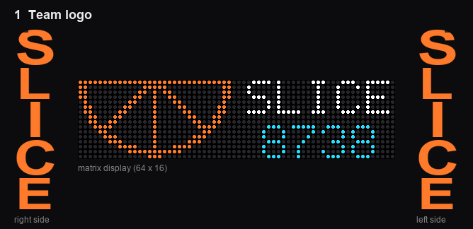 | 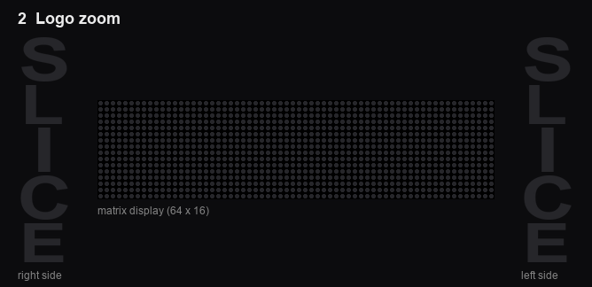 |
| 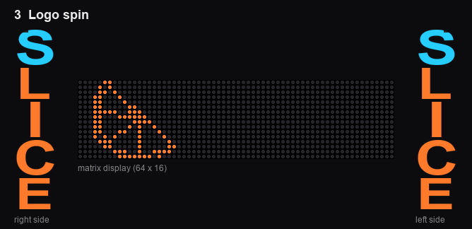 | 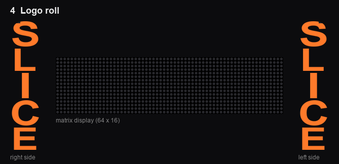 |
| 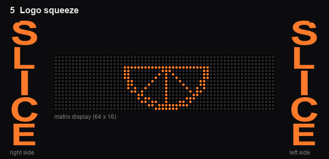 | 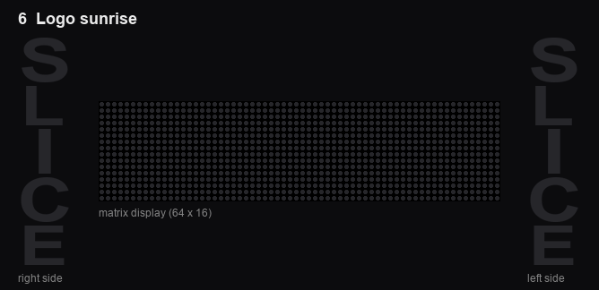 |
| 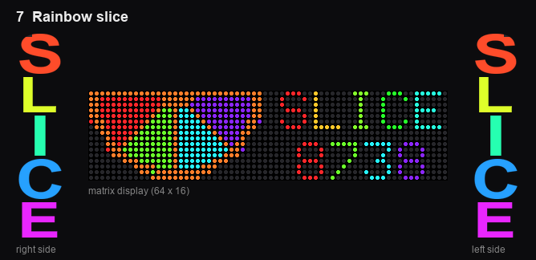 | 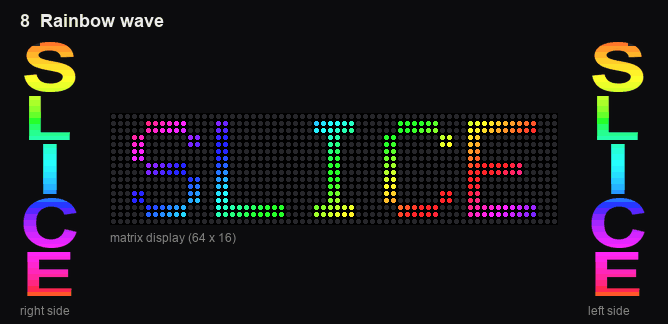 |
| 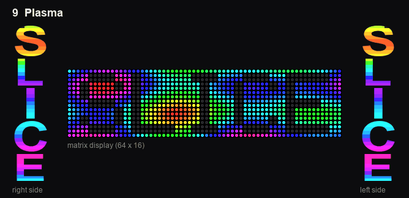 | 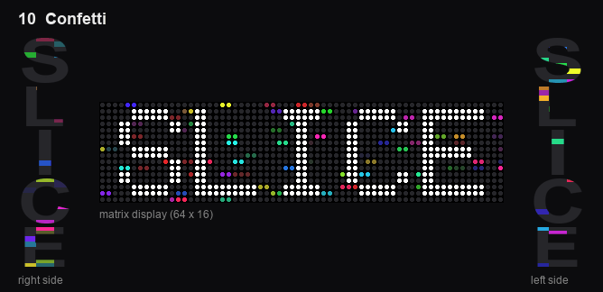 |
| 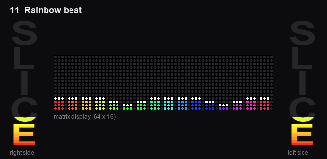 | 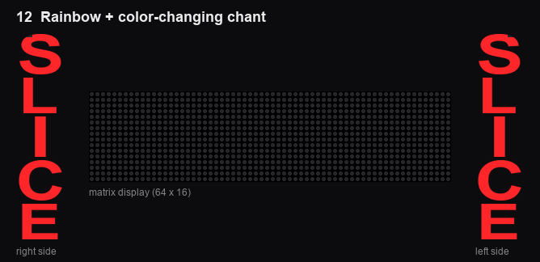 |
| 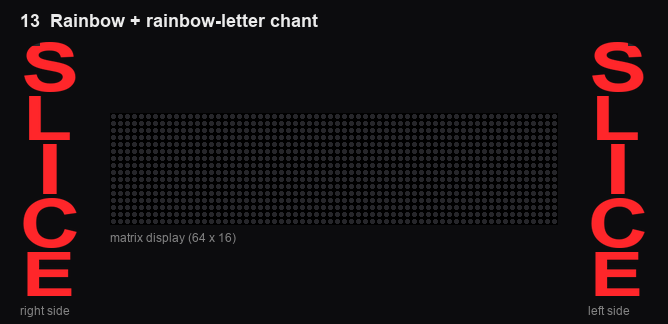 | 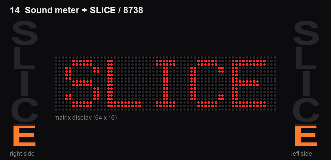 |
| 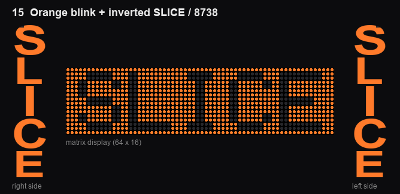 | 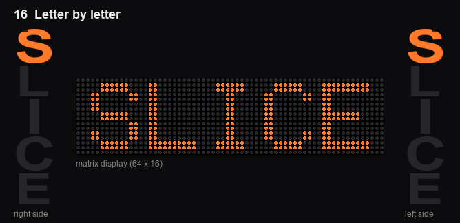 |
| 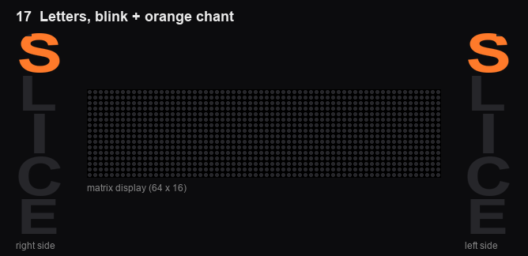 | 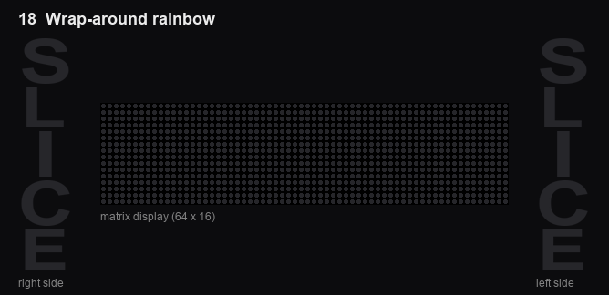 |
| 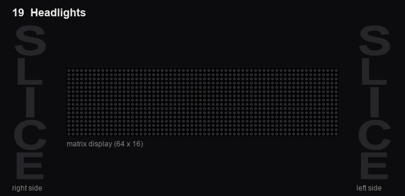 |  |

Programs 11 and 14 use a fake 120 BPM beat as the microphone input.

### The logo

Program 1 draws the logo from a 64 x 16 pixel-art table (`LOGO` in the sketch), generated by [`tools/logo_gen.py`](tools/logo_gen.py):

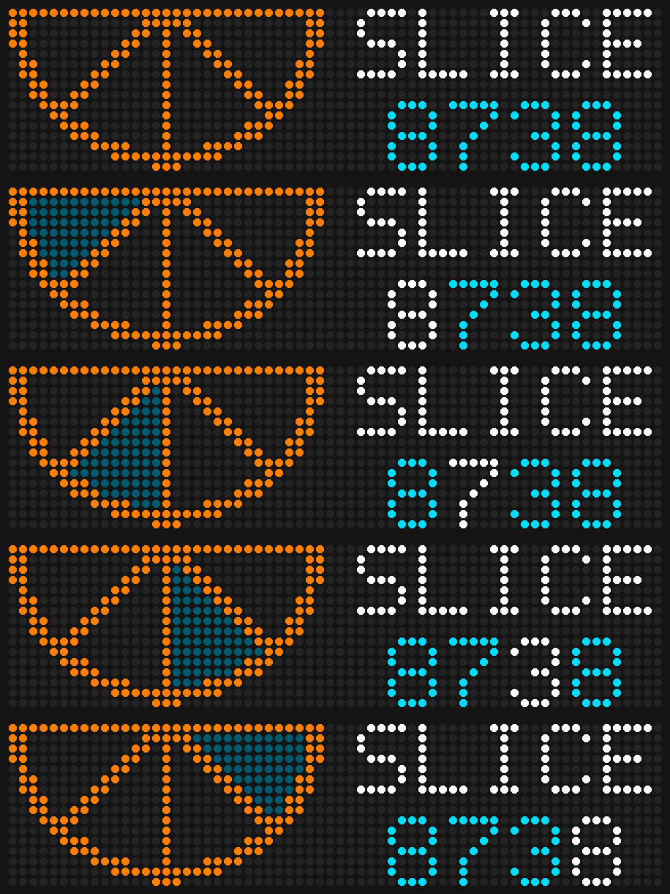

To change it:

```sh
pip install pillow
python tools/logo_gen.py docs/logo-preview.png   # prints the new LOGO rows
```

Check the preview image, then paste the printed rows into `LOGO` in the sketch.

## Building

1. Install the [Arduino IDE](https://www.arduino.cc/en/software).
2. Install these libraries from the Library Manager:
   - Adafruit NeoPixel
   - Adafruit NeoMatrix
   - Adafruit GFX Library
3. Open `SliceCartWithTimeManager/SliceCartWithTimeManager.ino`, select your board and port, and upload.

The two LED buffers need about 4 KB of RAM, so use an Arduino Mega or something bigger. An Uno doesn't have enough.

## How the code works

The sketch never blocks for long (apart from a small `delay` in scrolling text). `loop()` runs over and over, and on each pass it:

1. Reads the mic and stores `millis()` in `time`.
2. Works out how long the current side effect and the current matrix effect have been running (`timeInSideSequence`, `timeInScrollSequence`).
3. Checks the buttons.
4. Calls the side effect and the matrix effect for the selected program. Each one draws **one frame** based on the elapsed time and then returns.

That's what "time manager" refers to: a side effect and a matrix effect run at the same time without fighting over `delay()`.

Each effect follows the same pattern:

```cpp
void myEffect() {
  // True on the first frame after switching to this effect (timer reset to 0)
  if (startScroll("myEffect")) {
    // one-time setup
  }

  // Draw the frame for this point in time
  if (timeInScrollSequence < 1000) {
    showText("HI", ORANGE);
  } else {
    restartScroll();   // one cycle done, start over
  }
}
```

Side effects do the same with `startSide()`, `timeInSideSequence` and `restartSide()`. For an animation that loops, `logoAnimTime("name", cycleMs)` returns how far through the loop you are; see the logo programs for examples.

### Adding a new program

1. Write the effect function(s) using the pattern above.
2. Add a new `case` to the `switch (sequence)` in `loop()`.
3. Increase `LED_PROGRAMS`.

### Useful helpers

| Function | What it does |
|---|---|
| `setAll(r, g, b)` | Whole side strip one color, then show |
| `setRow(row, r, g, b)` | One row across all six columns |
| `setLetter(1..5, r, g, b)` | One letter (1 = S … 5 = E), then show |
| `setColumn(1..6, r, g, b)` | One column (1–3 right, 4–6 left) |
| `showText(text, color[, clear, inverted])` | Centered text on the matrix |
| `alternatePhrases(a, b, color, showMs, pauseMs[, inverted])` | Flip between two words |
| `coloredScrollingText(text, pauseMs, speed, color)` | Scroll text in one color |
| `rainbowScrollingText(text, pauseMs, colorSpeed, speed, perLetter)` | Scroll text in rainbow colors |
| `drawLogo(litMask)` | Draw the pixel-art logo once, with segments/digits in the bitmask lit |
| `drawSlice(pose, litMask, color, digits)` | Draw the orange slice at any position, size, rotation and stretch (see `SlicePose`) |
| `drawSmallText(x, y, text, color, count, fromX)` | First `count` characters in the small 5x7 font |
| `sideLetters(cyanMask, litMask, level)` | Side letters cyan / orange / off by bitmask (bit 0 = S), only updates the strip when it changes |
| `solidColor(r, g, b)` | Side strip one steady color |
| `phase(t, start, end)`, `easeOutCubic(t)`, ... | Animation timing helpers |
| `hueToRGB(hue, r, g, b)` / `hueColor(hue, level)` | Rainbow color for a hue 0–255 (wraps), for the strip / the matrix |
| `setRowHue(row, hue, level)` | One row of the side letters in a rainbow color |
| `sin8(x)` | Fast smooth wave (0–255) for plasma-style effects |
| `micLevel()` | Microphone volume 0–255, using the two pots for floor and gain |
| `ColorWheel.rollingRainbow(jump)` | Step through the rainbow; read `.red/.green/.blue` |

## Regenerating the previews

[`tools/preview/`](tools/preview) compiles the sketch for Windows against stand-in versions of the Arduino, NeoPixel and NeoMatrix libraries (in `mock/`) and the real Adafruit GFX library. It runs each program on a simulated clock and records what the LEDs show. It behaves like a Mega: `int` is 16 bits, and `millis()` stops counting while LEDs are being updated. Needs Visual Studio with the C++ workload, the Arduino libraries above, and Python with Pillow.

```sh
pip install pillow
python tools/preview/make_gifs.py        # all programs -> previews/
python tools/preview/make_gifs.py 2 3    # just programs 2 and 3
```

When you add a program, add it to `PROGRAMS` at the top of `make_gifs.py`.

## Timing on the Mega

- **Use `showStrip()` / `showMatrix()`, never `strip.show()` / `matrix.show()`.** While the Mega sends data to the LEDs, interrupts are switched off and `millis()` stops counting. Sending all 1,324 LEDs takes about 40 ms, but `millis()` only sees about 2 ms of it, so time-based effects used to run 10–20× slower than written. The wrappers add the missing time back, and the sketch reads time from `cartMillis()`.
- **Keep times in `unsigned long`.** An `int` on the Mega is 16 bits and overflows after about 32 seconds.
- **The display maxes out at about 24 frames a second.** Every LED takes 30 µs to send. Scrolling text moves 1 pixel per frame (`SCROLL_STEP`) because that's the smoothest it can go; 2 is twice as fast but jumpy.

## Known quirks

- In `noise()`, the gain calculation uses integer division, so turning the max pot only changes the gain in whole steps.
- `updateLEDs()` (sets a range) and `updateLeds()` (shows the strip) have confusingly similar names.
